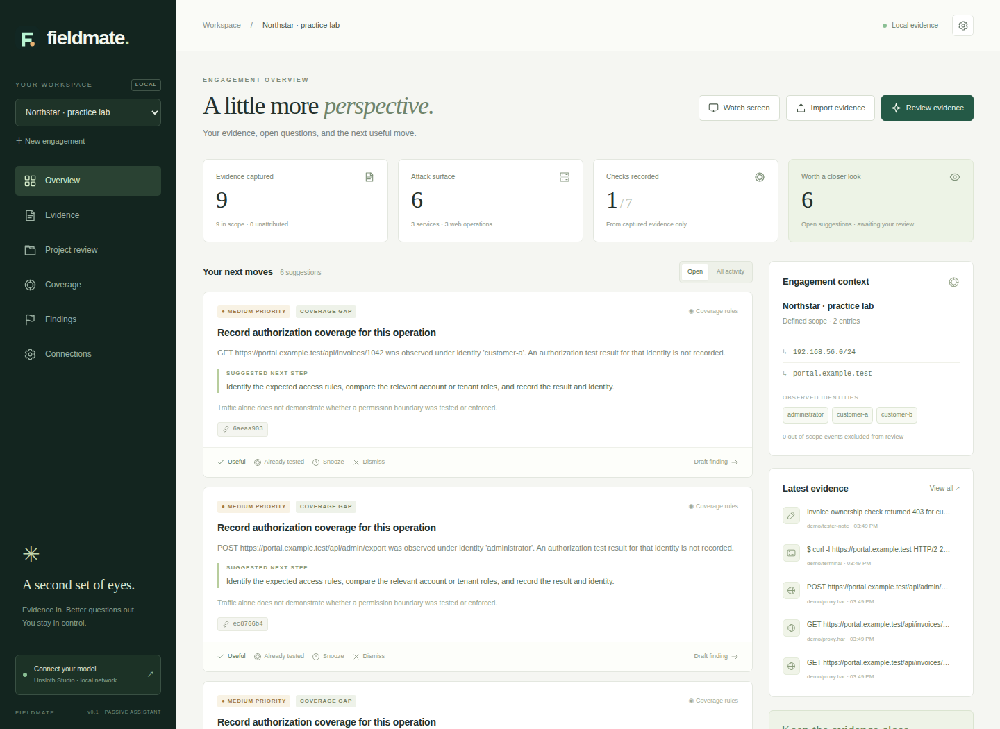

# Fieldmate

A passive pentest partner for Linux: terminal and proxy evidence, account-aware coverage, a findings workbench, selected-window capture, and suggestions from your Unsloth Studio server over the LAN.

The dashboard and collectors use **Python 3.10+ with no runtime dependencies**. The browser interface works on localhost in current Chromium/Chrome and Firefox. Terminal capture needs Linux/macOS; the dashboard and file imports also work on Windows. Chromium is recommended for screen sharing.



*Practice-lab screenshot: all targets, accounts, evidence, and findings shown are synthetic.*

## Start

From this directory:

```sh
./launch.sh
```

Or:

```sh
python3 -m fieldmate serve --open
```

The app listens at **http://127.0.0.1:8741**. `--open` launches an authenticated browser tab. The token is removed from the URL after loading and held in that tab's session storage. To open another tab later:

```sh
python3 -m fieldmate open
```

If you open the address directly, paste the local access token from `.fieldmate/token`. This token belongs to Fieldmate; it is different from your Unsloth API key.

The first screen offers **Create an engagement** and an explicitly synthetic **practice lab**. No targets are contacted by the practice lab.

## Review a `.burp` project and prepare manual Repeater tests

1. Open **Project review → Upload .burp project**. Native archives up to **10 GiB** are streamed to private local storage, unchanged. They are never sent to the model or opened/executed automatically.
2. Open/import a copy of the same project in Burp, with automated tasks paused. Build the companion JAR using the instructions below, then load `integrations/burp/build/libs/fieldmate-burp.jar`.
3. In the companion, apply the local Fieldmate URL/token, engagement ID, and **Project import ID** shown by Fieldmate. Live forwarding can stay disabled. Click **Import opened project (saved data only)**.
4. The companion reads saved Proxy history, site-map request/response pairs, and scanner issues, in batches. It does not scan or contact targets. Repeater-only tab data not exposed by Burp's API can be missing. Open the project using a compatible Burp version/edition.
5. Once evidence is imported, click **Review project**. The model reviews in-scope HTTP/scanner events in bounded batches and the UI shows progress, failed batches, and retained partial results. **Stop review** takes effect after the current inference request finishes.

**Uploading a native `.burp` archive alone does not decode or review it.** A standalone decoder for Burp's native project container is not implemented. The saved-data companion is the extraction path. You can instead attach readable Burp traffic XML, Burp **scanner issues XML**, HAR, or HTTP/scanner event JSONL to a linked project. Use **Add XML / HAR / JSONL** on its card. Text exports remain limited to 20 MB per file.

The project reviewer distinguishes **possible missed findings**, **needs validation**, **likely false positives**, and **insufficient evidence**. Assessments include supporting IDs, counter-evidence IDs, explicit false-positive checks, and manual follow-up tests. A likely-false-positive response without captured HTTP counter-evidence is rejected. Scanner confidence/severity are treated as claims, and a 403, reflected string, or identical status alone is not proof.

**Repeater request text** shows a captured baseline and, when grounded in evidence, a candidate with a specific change. Requests retain the captured destination. Credentials are replaced with placeholders; stale framing and connection headers are removed and Content-Length is rebuilt. Truncated bodies require restoration from the original project. Check the displayed TLS/host/port, replace placeholders, and paste into Repeater yourself. You can copy or download `.txt` files. There is **no Send, Execute, scan-start, or automatic Repeater action**. An individual in-scope HTTP event also offers a baseline Repeater template in its detail view.

Only **Record my decision** can mark a review item manually validated or manually ruled out. Model review never confirms, dismisses, or changes an existing finding automatically. Record reproduction results in Coverage and Findings. Reports include advisory review assessments and manual request text, clearly separated from manually confirmed findings.

Native archives remain unredacted in the private data directory. Only extracted, redacted, in-scope evidence is used for inference. Original uploaded files can be downloaded from Import setup. Chrome/Chromium streams archive downloads to a user-selected file. Browsers without that file-save API limit downloads to 100 MiB; copy larger archives from the private data directory instead. API routes for this workflow accept stored data and return text; none send requests to tested targets.

## Connect your Unsloth Studio server

1. Load your local model in Unsloth Studio.
2. In Unsloth, create a key under **Settings → API**. Enable LAN access for your trusted testing machine if needed.
3. In Fieldmate, open **Connections**.
4. Enter the API address, for example `http://192.168.1.50:8888/v1`, and the Unsloth key.
5. Click **Test & discover models**, choose the exact model ID, and **Save connection**.
6. Import evidence and click **Review evidence** on Overview.

The address and port must match your installation; 8888 is an example, not a discovery mechanism. A root API address is normalized to `/v1`. Fieldmate uses authenticated `GET /v1/models` and non-streaming `POST /v1/chat/completions`.

Use a local model and disable Unsloth's server-side tools. Fieldmate sends `enable_tools: false`, `enabled_tools: []`, and `tool_choice: "none"`. It executes no model tool calls. Fieldmate cannot inspect how your Unsloth installation routes a particular model, so choose a local model there.

If your server/model supports JSON output mode, enable it in Connections. Otherwise the model is instructed to return JSON, and Fieldmate validates the result. Invalid suggestions, unknown subjects, and invented evidence IDs are rejected. A syntactically valid suggestion is still a hypothesis requiring your judgment.

Enable **Send screenshots to a vision-capable model** only when the loaded model supports images. Text-only review excludes screenshot pixels. You can enable **background review** to review changed in-scope evidence at the configured interval. It is off initially.

The app has no cloud fallback and does not download or install models.

Official API reference: [Unsloth API](https://unsloth.ai/docs/basics/api).

## Engagement scope and identity

Scope entries are host-level: IP addresses, CIDRs, exact hostnames, and `*.example.test` wildcard subdomains. A wildcard excludes the bare parent domain. Scope matching does not resolve target DNS: list both a hostname and its IP/CIDR when you use both representations. Ports and URL paths do not narrow scope; a URL scope entry represents its hostname.

Out-of-scope and unattributed events remain visible in the evidence library, but are excluded from rules and model review. Text imports, terminal sessions, notes, and screenshots need a target label. Structured Nmap/HTTP imports provide their own targets. Scope is based on the event target, not an inspection of every address mentioned inside a transcript or screenshot.

Label traffic as `customer-a`, `customer-b`, `administrator`, a tenant, or another useful identity. Import different account sessions separately, or change the Burp extension's identity before generating new traffic. In an Evidence detail view, **Change identity** updates one event or all events of the same type from that source. Evidence IDs stay stable. Existing test records keep their original identity and can be edited in Coverage.

## Capture terminal output

Get the engagement ID from Connections or:

```sh
python3 -m fieldmate list
```

Start a captured interactive shell:

```sh
python3 -m fieldmate capture \
  --engagement ENGAGEMENT_ID \
  --target 192.168.56.12 \
  --identity tester
```

Work normally and `exit` to stop. The parent records PTY **output**, including echoed commands; it does not retain raw input keystrokes. Bash sessions also use a temporary prompt hook to record completed command history, local working directory, and exit status. Shell history settings can suppress command entries. Other shells still supply output. A local Bash hook does not expose the working directory or command exit status inside an SSH session; label remote sessions appropriately.

Failed sends and an excessive queued backlog are saved as redacted `.fieldmate/unsent-SESSION.jsonl`. Recover them with the normal import command. Collectors never ask the model to execute commands.

You can also use the Linux `script` utility and watch its growing output:

```sh
script --quiet --flush --log-out evidence/terminal.log --log-timing evidence/terminal.time
```

Create the `evidence` directory first. Avoid `--log-in`/`--log-io` for routine collection: these can capture passwords even when echo is disabled. Printed output can still contain secrets.

## Import and watch files

The **Import evidence** button accepts:

| Format | Contents |
|---|---|
| Nmap XML | Open services, products, versions, script observations |
| Burp XML | HTTP-history exports and scanner issue reports, including base64 requests/responses |
| HAR | HTTP traffic exported from Burp, ZAP, or a browser |
| JSONL / NDJSON | One Fieldmate event object per line |
| `.log` / `.txt` | Terminal output, with a target label |

Imports are capped at 20 MB and 10,000 records. Split larger exports first. Bodies are excerpted; binary HAR response bodies are omitted. Importing the same evidence again is deduplicated.

```sh
python3 -m fieldmate import examples/network.xml --engagement ENGAGEMENT_ID

python3 -m fieldmate import customer-a.har \
  --engagement ENGAGEMENT_ID --identity customer-a

python3 -m fieldmate import terminal.log \
  --engagement ENGAGEMENT_ID --target portal.example.test

python3 -m fieldmate watch ./evidence \
  --engagement ENGAGEMENT_ID --target portal.example.test --identity tester
```

The watcher checks stable files every two seconds, imports existing exports, and tails growing `.log`/`.txt` files by byte offset. Hidden paths, symlink files, and Fieldmate's data directory are excluded. It runs in the foreground until Ctrl+C. If the watcher is restarted, structured exports are deduplicated; modified text files can be re-ingested as new chunks.

JSONL example:

```json
{"kind":"note","source":"field-note","target":"portal.example.test","identity":"customer-a","content":"Expected rule: a customer can read only their own invoices.","metadata":{}}
```

Event kinds: `terminal`, `command`, `service`, `http`, `note`, `screenshot`. For live integrations, POST `{"events":[...]}` to `/api/engagements/ID/events` with the **Fieldmate** bearer token. Service metadata needs a port and protocol; HTTP metadata needs a URL and method. See `fieldmate/ingest.py` for normalized fields and `examples/session.jsonl` for an example sequence.

## Live Burp companion

Build the extension from the reviewed source with JDK 17+ and Gradle:

```sh
cd integrations/burp
gradle jar
cd ../..
```

Load `integrations/burp/build/libs/fieldmate-burp.jar`. Generated binaries are excluded from the source repository.

1. In Burp, open **Extensions → Installed → Add**, choose Java, and load the JAR.
2. Open the **Fieldmate** Burp tab.
3. Enter the local Fieldmate URL, its `.fieldmate/token`, and engagement ID.
4. Set the identity label and add intended targets to Burp's Target scope.
5. Enable forwarding and apply configuration.

The extension observes responses, forwards associated request/response evidence on a worker thread, and returns traffic unchanged. It has a bounded 200-message queue and sent/failed/dropped counters. It forwards only URLs in Burp Target scope; Fieldmate separately checks engagement scope. Tokens stay in extension memory and must be entered again after reload. Export HTTP history as XML to recover failed/dropped messages.

Compiled against Montoya API 2026.7 with Java 17 class compatibility. No Gradle wrapper binary is bundled. Compilation is verified; loading into a running Burp instance still needs checking on your installed Burp version. ZAP is supported via HAR import; a live ZAP bridge is not included.

## Watch a screen or window

Choose **Watch screen** on Overview, add a target and identity label, then select the window/screen in the browser sharing prompt. Changed frames are sampled approximately every 20 seconds, resized to at most 1440 pixels wide, and stored as JPEG. Stop from Fieldmate or the browser's sharing control. Switching engagements stops capture. Sharing does not resume automatically after a reload.

Screenshots are **not image-redacted**. Use a specific target window to exclude unrelated applications. A snapshot can miss transient output; terminal and proxy collectors provide more complete evidence. Browser scheduling and desktop portal support can affect capture, especially in background tabs. Pixels are sent only during review when vision is enabled, with at most two selected images per request.

## Suggestions, coverage, and findings

- **Coverage rules** identify services and web operations without a recorded check for the observed identity.
- **Evidence signals** flag recognizable stack/database errors, credential-bearing HTTP URLs, and positive Nmap script markers for manual validation. Proxy topology and scanner accuracy must be checked. High priority means review priority, not confirmed severity.
- **Model review** connects selected evidence, tests, business context, and feedback, returning at most five suggestions per call.
- **Useful / Already tested / Snooze / Dismiss** controls shape the queue. Snooze lasts 30 minutes. Already tested records an attempted check; add the actual result in Coverage.
- **Findings** are created explicitly by you or drafted from a suggestion. Confirmation requires reproduction steps, impact, and evidence from the same engagement.
- **Export report** downloads the scope, notes, findings, supporting excerpts, and test records as Markdown.

Unobserved means not recorded here. The system cannot establish that you missed a finding or that an unobserved test never happened. Coverage rules are deliberately conservative and can produce basic reminders; the model's quality depends on the loaded model and supplied context.

Context selection prioritizes matching question terms, recency, and diverse subjects. The serialized context is capped by the configured character budget, includes excerpts, and does not contain the full engagement. General review ranks at most 256 candidate events before applying the prompt budget. Project review processes all eligible saved events from its starting snapshot in separate batches; it does not compare every possible pair across batches. Compact inventory and assessment counts still grow with the dataset. Repeated requests can be omitted. No embeddings service is required.

## Replay and evaluate

Use a new, empty engagement to replay events in file order without revealing future evidence:

```sh
python3 -m fieldmate create "Replay lab" --scope portal.example.test

python3 -m fieldmate replay examples/session.jsonl \
  --engagement NEW_EMPTY_ENGAGEMENT_ID \
  --delay 1 --review-every 1
```

Replay blocks between review intervals until each review finishes. Existing nonempty engagements are rejected. For accuracy evaluation, compare suggestions with known lab outcomes and record useful leads, false positives, repeated suggestions, and when each lead became available. The included test model is synthetic; it is not a benchmark of pentest reasoning quality.

## Storage and boundaries

Default data: `.fieldmate/` in the working directory. Use the same data path for the server and collectors:

```sh
python3 -m fieldmate --data /path/to/private-data serve --open
python3 -m fieldmate --data /path/to/private-data capture --engagement ID --target HOST
```

`FIELDMATE_DATA` and `FIELDMATE_URL` can supply those defaults. Use `serve --port PORT` and `--url http://127.0.0.1:PORT` together for a different local port. Global CLI options come before the subcommand.

The directory is mode 0700; token/database and collector-created files are private. It contains SQLite evidence, screenshot data, the Fieldmate token, and the configured Unsloth key. Storage is not encrypted by the application: use an encrypted local volume if needed. Back up the complete data directory while stopped. No automatic deletion or retention policy is enabled.

Text redaction covers common credential headers, secret fields, bearer/JWT/key formats, and private-key blocks **before persistence**. Cookie security attributes are retained separately from cookie values. Redaction is best effort and does not identify every possible secret. Imported original files are untouched.

The dashboard binds to loopback and requires bearer authentication for API and evidence access, with Origin/Host checks, no CORS, and a restrictive Content Security Policy. Inference permits only loopback, RFC1918 IPv4, and IPv6 ULA destinations; public, link-local, and multicast destinations are rejected. DNS answers are checked and the selected IP is pinned for the connection. Redirects and environment proxies are not followed. HTTPS certificate verification remains enabled.

Prompt injection remains a model risk: target material is labeled untrusted, citations are checked, and there is no command execution path from model output. Do not treat a model conclusion as proof.

## Public source and privacy

The repository includes source, tests, synthetic examples, and the demo screenshot. Your `.fieldmate/` directory, model API key, token, uploads, databases, captures, reports, and generated binaries are excluded. Never add real client exports or screenshots to the repository. See [PUBLISHING.md](PUBLISHING.md) for the audited source-package workflow and [SECURITY.md](SECURITY.md) for data boundaries.

No open-source license has been selected yet.

## Verification

Backend and actual collector integration tests:

```sh
python3 -m unittest discover -s tests -v
```

Optional browser tests require Node.js and Playwright, with Chrome or Playwright Chromium installed:

```sh
node tests/browser.cjs
```

Set `FIELDMATE_PLAYWRIGHT_PATH` to your Playwright module directory or install `playwright` locally for the test. `FIELDMATE_CHROME` can specify a browser executable. These are development dependencies only. Browser tests use disposable local app and synthetic model servers; screen selection is simulated, so they never capture your desktop. Preview images are generated from synthetic data.

## Troubleshooting

| Problem | Check |
|---|---|
| Model connection fails | Server address/port, LAN firewall, loaded model, API key, and `/v1/models` availability |
| 401/403 from inference | Create/check the key in Unsloth Settings → API |
| Invalid model JSON | Enable supported JSON mode, increase response budget, or adjust reasoning/model settings |
| No evidence eligible for review | Target labels, hostname/IP representation, scope, and identity attribution |
| Captures don't appear | Same `--data` and `--url` for both processes; look for private `unsent-*.jsonl` files |
| No Bash command events | Shell history and PROMPT_COMMAND customization; PTY output still records |
| Browser asks for a token | Use `python3 -m fieldmate open` or copy `.fieldmate/token` |
| Screen chooser unavailable | Use the localhost URL in a desktop browser with screen-sharing/portal support |
| Address already in use | Reopen the existing app or choose another port |
